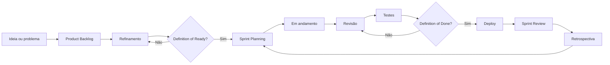

# Agile com Squad Framework

Entrega de Agile Methodology with Squad Framework da Xepa Solidária.

O documento completo está em [`squad-e-backlog.pdf`](squad-e-backlog.pdf). Ele traz:

- a visão do produto;
- por que usamos o modelo de squads;
- a estrutura da squad e os papéis;
- os rituais;
- a Definition of Ready e a Definition of Done;
- o backlog com 18 histórias de usuário;
- as três sprints e o quadro Kanban;
- o fluxograma de trabalho;
- a retrospectiva.

## Squad Xepa

| Integrante | RM | Papel |
|---|---|---|
| José Henrique Escobar | 564419 | Product Owner |
| Arthur Pastorello | 562345 | Agile Master e experiência imersiva (AR/VR) |
| Kazys | 564020 | Tech Lead e desenvolvimento |
| Gustavo Estevam Cocchi | 562472 | Dados e indicadores |
| Juan Pablo Molina Molina | 564445 | Experiência imersiva (AR/VR), testes e qualidade |

A squad se divide em três chapters por competência: Desenvolvimento, Dados e Experiência imersiva. A guild de Qualidade reúne todos para revisar as entregas antes de cada review.

## Sprints

| Sprint | Período | Meta |
|---|---|---|
| 1 | 03/11 a 09/11 | Base do app: cadastro, login, publicação e ofertas próximas |
| 2 | 10/11 a 16/11 | Ciclo da doação completo e app publicado |
| 3 | 17/11 a 19/11 | Entregas de cada disciplina e documentação |

## Fluxo de trabalho

