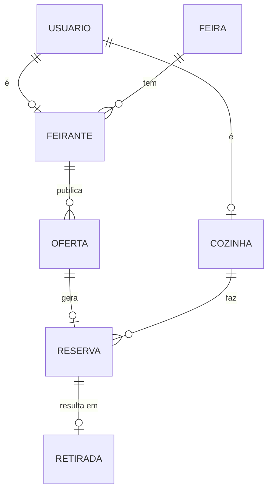

# Banco de dados

Entrega de Database Design da Xepa Solidária.

O documento completo está em [`modelo-de-dados.pdf`](modelo-de-dados.pdf). Ele traz:

- a escolha do banco;
- as regras de negócio transformadas em restrições;
- o modelo conceitual e o modelo lógico (diagrama ER);
- a normalização até a 3FN;
- o dicionário de dados;
- o fluxograma da doação;
- as consultas dos indicadores, com os resultados.

## Resumo

| Item | Escolha |
|---|---|
| Banco | PostgreSQL 17, gerenciado pela Neon (AWS us-east-2) |
| Versionamento do esquema | Flyway, com as migrações em `api/src/main/resources/db/migration` |
| Tabelas | `usuario`, `feira`, `feirante`, `cozinha`, `oferta`, `reserva`, `retirada` |
| Forma normal | 3FN |



## Scripts

| Arquivo | Conteúdo |
|---|---|
| [`01_criar_tabelas.sql`](scripts/01_criar_tabelas.sql) | Tabelas, chaves, restrições e índices |
| [`02_inserir_feiras.sql`](scripts/02_inserir_feiras.sql) | As 5 feiras da área piloto |
| [`03_inserir_dados_demonstracao.sql`](scripts/03_inserir_dados_demonstracao.sql) | Dados de demonstração |
| [`04_consultas_indicadores.sql`](scripts/04_consultas_indicadores.sql) | Consultas dos indicadores do painel |

Para recriar o banco, execute os arquivos em ordem num PostgreSQL vazio:

```bash
psql -d xepa -f scripts/01_criar_tabelas.sql
psql -d xepa -f scripts/02_inserir_feiras.sql
psql -d xepa -f scripts/03_inserir_dados_demonstracao.sql
psql -d xepa -f scripts/04_consultas_indicadores.sql
```

Com os dados de demonstração, a primeira consulta mostra 205,20 kg recuperados em 8 retiradas. É o mesmo número do painel do site.
