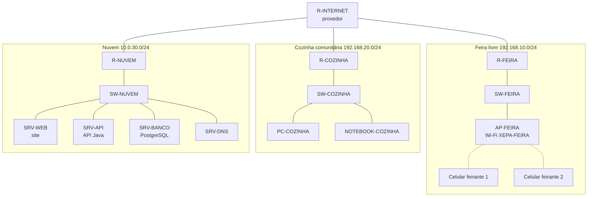

# Rede da Xepa Solidária

Entrega de Network Architect Solutions. Topologia montada no Cisco Packet Tracer: [`xepa-solidaria.pkt`](xepa-solidaria.pkt).

## Cenário

A Xepa Solidária liga três pontos pela internet:

- **Feira livre:** feirantes publicam as sobras pelo celular, na rede Wi-Fi da feira.
- **Cozinha comunitária:** a equipe reserva as ofertas e confirma as retiradas pelo computador.
- **Nuvem:** onde ficam o site, a API, o banco de dados e o DNS.

O roteador **R-INTERNET** representa o provedor que conecta os três pontos. O roteamento entre eles é dinâmico, com OSPF.

## Equipamentos

| Nome | Modelo no Packet Tracer | Função |
|---|---|---|
| R-INTERNET | Router 2911 | Provedor que interliga os três pontos |
| R-FEIRA, R-COZINHA, R-NUVEM | Router 2911 | Gateway de cada ponto, DHCP e OSPF |
| SW-FEIRA, SW-COZINHA, SW-NUVEM | Switch 2960 | Rede local de cada ponto |
| AP-FEIRA | AccessPoint-PT | Wi-Fi da feira, WPA2 |
| Celular feirante 1 e 2 | Smartphone-PT | Feirantes publicando ofertas |
| PC-COZINHA | PC-PT | Computador da cozinha |
| NOTEBOOK-COZINHA | Laptop-PT | Notebook da cozinha |
| SRV-WEB, SRV-API, SRV-BANCO, SRV-DNS | Server-PT | Serviços da aplicação |

## Endereçamento

| Rede | Endereço | Gateway | Como os IPs são distribuídos |
|---|---|---|---|
| Feira | 192.168.10.0/24 | 192.168.10.1 | DHCP do R-FEIRA, de .100 em diante |
| Cozinha | 192.168.20.0/24 | 192.168.20.1 | DHCP do R-COZINHA, de .100 em diante |
| Nuvem | 10.0.30.0/24 | 10.0.30.1 | Fixos |
| R-INTERNET ↔ R-FEIRA | 10.0.0.0/30 | | .1 no R-INTERNET, .2 no R-FEIRA |
| R-INTERNET ↔ R-COZINHA | 10.0.0.4/30 | | .5 no R-INTERNET, .6 no R-COZINHA |
| R-INTERNET ↔ R-NUVEM | 10.0.0.8/30 | | .9 no R-INTERNET, .10 no R-NUVEM |

| Servidor | IP | Serviço |
|---|---|---|
| SRV-WEB | 10.0.30.10 | HTTP, site `xepa-solidaria.vercel.app` |
| SRV-API | 10.0.30.20 | HTTP, API `xepa-solidaria-api.onrender.com` |
| SRV-BANCO | 10.0.30.30 | Banco PostgreSQL, sem acesso externo |
| SRV-DNS | 10.0.30.53 | DNS dos dois nomes acima |

Os servidores usam máscara 255.255.255.0, gateway 10.0.30.1 e DNS 10.0.30.53.

## Decisões

- **OSPF em área única:** os roteadores aprendem as redes sozinhos. Se um novo ponto entrar, basta anunciar a rede dele. As interfaces das redes locais ficam passivas, sem enviar mensagens OSPF para os usuários.
- **DHCP nos roteadores da feira e da cozinha:** celulares e computadores entram na rede sem configuração manual e já recebem o DNS da nuvem.
- **Wi-Fi com WPA2** na feira, porque os feirantes usam o celular.
- **ACL `PROTEGE-NUVEM` no R-NUVEM:** de fora, só passam HTTP e HTTPS para o site e a API, DNS e ping para esses servidores. O banco de dados não é acessível por ninguém de fora da nuvem, só pela API, que está na mesma rede. É a mesma ideia da aplicação real, em que o banco na Neon só recebe conexões da API.

## Como montar

1. **Equipamentos:** coloque os dispositivos da tabela de equipamentos e renomeie cada um (clique no dispositivo, aba **Config**, campo **Display Name**).
2. **Cabos:**
   - Roteador com roteador: **Copper Cross-Over**.
     - R-INTERNET Gig0/0 → R-FEIRA Gig0/1
     - R-INTERNET Gig0/1 → R-NUVEM Gig0/1
     - R-INTERNET Gig0/2 → R-COZINHA Gig0/1
   - Gig0/0 de cada roteador → porta Gig0/1 do switch do seu ponto: **Copper Straight-Through**.
   - Switches para PCs, servidores e AP: **Copper Straight-Through**.
3. **Roteadores:** abra cada roteador, aba **CLI**, aperte Enter e cole o arquivo correspondente da pasta [`configuracoes`](configuracoes).
   - Se aparecer a pergunta *initial configuration dialog*, responda `no`.
4. **AP-FEIRA:** aba **Config**, **Port 1**.
   - SSID: `XEPA-FEIRA`
   - Autenticação: **WPA2-PSK**, senha `xepa2026`
5. **Celulares:** aba **Config**, **Wireless0**.
   - SSID `XEPA-FEIRA`, WPA2-PSK, senha `xepa2026`
   - IP Configuration em **DHCP**
6. **PC-COZINHA e NOTEBOOK-COZINHA:** aba **Desktop**, **IP Configuration**, marque **DHCP**.
7. **Servidores:** aba **Desktop**, **IP Configuration**, preencha o IP da tabela, máscara 255.255.255.0, gateway 10.0.30.1 e DNS 10.0.30.53. Depois, na aba **Services**:
   - **SRV-WEB:** HTTP ligado. Edite o `index.html` com o título "Xepa Solidária".
   - **SRV-API:** HTTP ligado. Troque o conteúdo do `index.html` por `{"status":"UP"}`.
   - **SRV-BANCO:** desligue HTTP e HTTPS.
   - **SRV-DNS:** DNS ligado, com dois registros do tipo A:
     - `xepa-solidaria.vercel.app` → 10.0.30.10
     - `xepa-solidaria-api.onrender.com` → 10.0.30.20

## Testes

| Teste | Onde | Resultado esperado |
|---|---|---|
| `show ip route` | R-INTERNET | Rotas OSPF (O) para 192.168.10.0, 192.168.20.0 e 10.0.30.0 |
| `show ip ospf neighbor` | R-INTERNET | Três vizinhos em FULL |
| IP Configuration | Celular feirante 1 | IP 192.168.10.100 ou seguinte, recebido por DHCP |
| Navegador: `http://xepa-solidaria.vercel.app` | Celular feirante 1 | Abre a página do SRV-WEB |
| Navegador: `http://xepa-solidaria-api.onrender.com` | PC-COZINHA | Mostra `{"status":"UP"}` |
| `ping 10.0.30.10` | PC-COZINHA | Responde |
| `ping 10.0.30.30` | PC-COZINHA | Não responde: o banco está protegido pela ACL |
| `show access-lists` | R-NUVEM | Contadores de pacotes nas regras usadas |

Na primeira vez, o ping pode perder um ou dois pacotes enquanto a rede aprende os endereços (ARP). Repita o comando.
